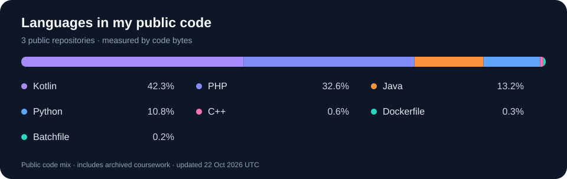
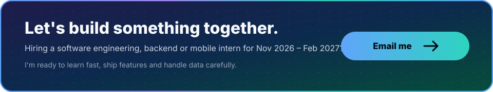

<a href="mailto:amirulharith505@gmail.com"></a>

<p align="center">
  <a href="mailto:amirulharith505@gmail.com"></a>
  <a href="https://github.com/Tendo505?tab=repositories"></a>
  
</p>


## ⚡ About me

I'm **Muhammad Amirul Harith bin Zakaria**, a **Computer Science diploma student at International Islamic College** who likes building the *whole* path of an app — the **Android screen** in your hand, the **Laravel API** behind it and the **database** that keeps it all consistent.

```kotlin
object AmirulHarith {
    val role        = "Computer Science diploma student · Android & backend developer"
    val education   = "Diploma in Computer Science @ International Islamic College (CGPA 3.30)"
    val award       = "Dean's List — Faculty of ICT, Semester 1, Session 2025/2026"
    val stack       = listOf("Kotlin", "Java", "Laravel", "PostgreSQL", "REST APIs", "Retrofit")
    val lookingFor  = "Software engineering, backend or mobile development internship"
    val available   = "30 Nov 2026 → 19 Feb 2027 (3-month industrial training)"
    val speaks      = listOf("Malay (native)", "English (working proficiency)")
}
```

## 🚀 Featured builds

<a href="https://github.com/Tendo505/PawCare"></a>

<p>
  <a href="https://github.com/Tendo505/PhoneMarketTracker"></a>
  
</p>

## 🛠️ Tech arsenal

<p align="center">
  <a href="https://github.com/tandpfun/skill-icons"></a>
</p>

| | |
| :--- | :--- |
| 📱 **Mobile** | Kotlin · Java · Android Studio · XML layouts · Retrofit |
| ⚙️ **Backend** | Laravel · REST APIs · MVC architecture · CRUD services · PHP |
| 🗄️ **Databases** | PostgreSQL · MySQL · SQLite · Microsoft Access · pgAdmin · relational design |
| 🌐 **Web** | JavaScript · HTML · CSS |
| 🧰 **Tools** | Git · GitHub · Postman · XAMPP · VS Code |

## 🧭 My journey



## 📊 Languages in my public code



<!-- LANGUAGE_DATA_START -->
**Kotlin 47.4%** · **PHP 36.6%** · **Java 14.8%** · **C++ 0.7%** · **Batchfile 0.3%** · **Dockerfile 0.2%**
<!-- LANGUAGE_DATA_END -->

<sub>From GitHub's language byte counts across public, non-fork repositories (including archived coursework, excluding this profile repo). Refreshes daily.</sub>

## 🐍 Contribution activity

<picture>
  <source media="(prefers-color-scheme: dark)" srcset="https://raw.githubusercontent.com/Tendo505/Tendo505/output/snake-dark.svg" />
  <source media="(prefers-color-scheme: light)" srcset="https://raw.githubusercontent.com/Tendo505/Tendo505/output/snake.svg" />
  
</picture>

<br />

<a href="mailto:amirulharith505@gmail.com"></a>

<p align="center"><sub>Header, stats, project, journey and language cards hand-made in this repo · Skill icons by <a href="https://github.com/tandpfun/skill-icons">Skill Icons</a> · Badges by <a href="https://github.com/badges/shields">Shields</a> · Snake by <a href="https://github.com/Platane/snk">Platane/snk</a></sub></p>
