<a href="mailto:amirulharith505@gmail.com"></a>

<p align="center">
  <a href="mailto:amirulharith505@gmail.com"></a>
  <a href="https://github.com/Tendo505?tab=repositories"></a>
  
</p>


## ⚡ About me

I'm **Amirul Harith**, a **Computer Science student** who likes building the *whole* path of an app — the **Android screen** in your hand, the **API** behind it (Laravel or Spring Boot) and the **database** that keeps it all consistent. I care about the parts that are easy to get wrong: concurrency, money math, offline use and accessibility, and I write tests that prove them.

```kotlin
object AmirulHarith {
    val role        = "Computer Science student · Android & backend developer"
    val award       = "Dean's List — Faculty of ICT, Semester 1, Session 2025/2026"
    val stack       = listOf("Kotlin", "Java", "Jetpack Compose", "Spring Boot", "Laravel", "PostgreSQL", "TypeScript")
    val lookingFor  = "Software engineering, backend or mobile development internship"
    val available   = "30 Nov 2026 → 19 Feb 2027 (3-month industrial training)"
    val speaks      = listOf("Malay (native)", "English (working proficiency)")
}
```

## 🚀 Featured builds

<a href="https://github.com/Tendo505/roadpulse"></a>

<a href="https://github.com/Tendo505/PawCare"></a>

<p>
  <a href="https://github.com/Tendo505/simpan">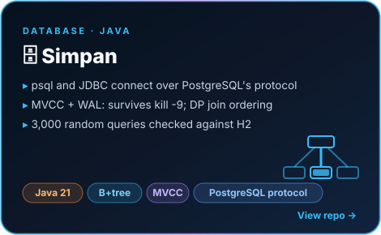</a>
  <a href="https://github.com/Tendo505/saku">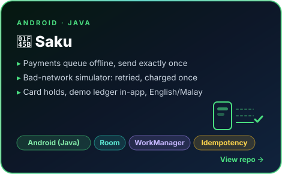</a>
</p>
<p>
  <a href="https://github.com/Tendo505/ledger">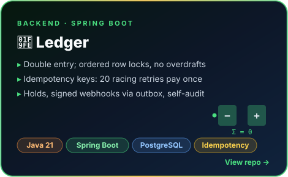</a>
  <a href="https://github.com/Tendo505/quorum">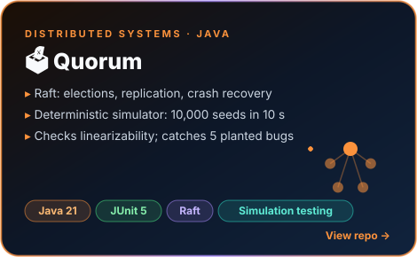</a>
</p>
<p>
  <a href="https://github.com/Tendo505/strata">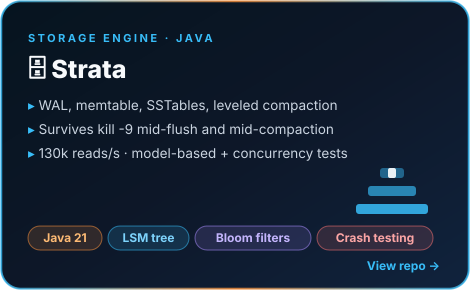</a>
  <a href="https://github.com/Tendo505/tandem">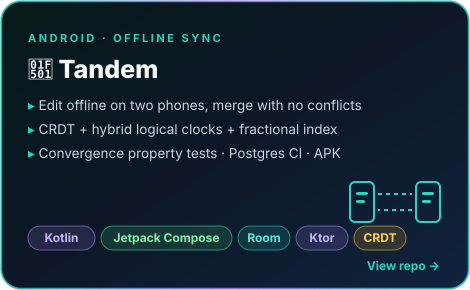</a>
</p>
<p>
  <a href="https://github.com/Tendo505/sift">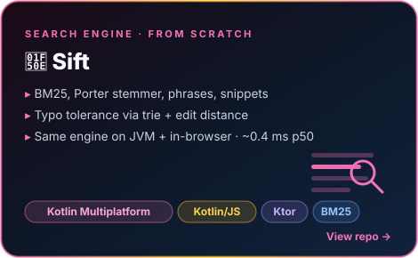</a>
  <a href="https://github.com/Tendo505/seatlock"></a>
</p>
<p>
  <a href="https://github.com/Tendo505/seatlock-android">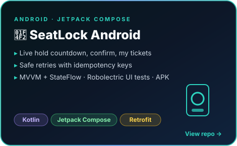</a>
  <a href="https://github.com/Tendo505/quill">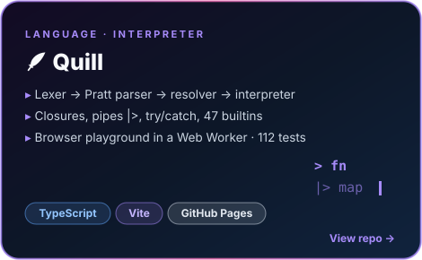</a>
</p>
<p>
  <a href="https://github.com/Tendo505/tally">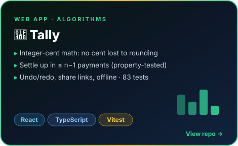</a>
  <a href="https://github.com/Tendo505/emberkv">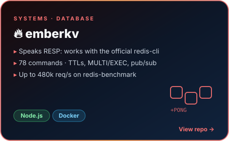</a>
</p>
<p>
  <a href="https://github.com/Tendo505/typeflow">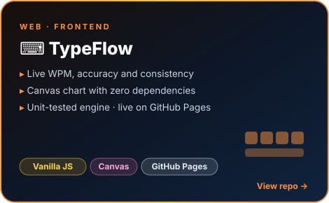</a>
  <a href="https://github.com/Tendo505/PhoneMarketTracker"></a>
</p>
<p>
  <a href="https://github.com/Tendo505/banking-app"></a>
  
</p>
<p>
  <a href="https://github.com/Tendo505/java"></a>
</p>

### 🌐 Try them live

| Project | Link |
| :--- | :--- |
| 🧭 RoadPulse (Android) | [Download the APK](https://github.com/Tendo505/roadpulse/releases/latest) |
| 👛 Saku (Android) | [Download the APK](https://github.com/Tendo505/saku/releases/latest) |
| 🔁 Tandem (Android) | [Download the APK](https://github.com/Tendo505/tandem/releases/latest) |
| 📲 SeatLock (Android) | [Download the APK](https://github.com/Tendo505/seatlock-android/releases/latest) |
| 🗳️ Quorum: Raft, replayed | [tendo505.github.io/quorum](https://tendo505.github.io/quorum/) |
| 🔎 Sift search demo | [tendo505.github.io/sift](https://tendo505.github.io/sift/) |
| 🪶 Quill playground | [tendo505.github.io/quill](https://tendo505.github.io/quill/) |
| 💸 Tally | [tendo505.github.io/tally](https://tendo505.github.io/tally/) |
| ⌨️ TypeFlow | [tendo505.github.io/typeflow](https://tendo505.github.io/typeflow/) |

## 🛠️ Tech arsenal

<p align="center">
  <a href="https://github.com/tandpfun/skill-icons"></a>
</p>

| | |
| :--- | :--- |
| 📱 **Mobile** | Kotlin · Java · Jetpack Compose · XML layouts · Retrofit · MapLibre · SQLite · Robolectric |
| ⚙️ **Backend** | Spring Boot · Laravel · Node.js · REST APIs · MVC · Flyway · concurrency-safe SQL |
| 🗄️ **Databases** | PostgreSQL · MySQL · SQLite · Microsoft Access · pgAdmin · relational design |
| 🌐 **Web** | TypeScript · React · JavaScript · Vite · HTML · CSS |
| 🧰 **Tools** | Git · GitHub Actions (CI/CD) · Docker · Gradle · Postman · XAMPP · VS Code |

## 📊 Languages in my public code


<!-- LANGUAGE_DATA_START -->
**Java 38.1%** · **Kotlin 32.7%** · **TypeScript 7.7%** · **JavaScript 7.7%** · **PHP 7.1%** · **Python 2.3%** · **CSS 2.1%** · **HTML 1.7%** · **Dockerfile 0.2%** · **Shell 0.2%** · **C++ 0.1%** · **Batchfile 0.1%**
<!-- LANGUAGE_DATA_END -->

<sub>From GitHub's language byte counts across public, non-fork repositories (including archived coursework, excluding this profile repo). Refreshes daily.</sub>

## 🐍 Contribution activity

<picture>
  <source media="(prefers-color-scheme: dark)" srcset="https://raw.githubusercontent.com/Tendo505/Tendo505/output/snake-dark.svg" />
  <source media="(prefers-color-scheme: light)" srcset="https://raw.githubusercontent.com/Tendo505/Tendo505/output/snake.svg" />
  
</picture>

<br />

<a href="mailto:amirulharith505@gmail.com"></a>

<p align="center"><sub>Header, stats, project and language cards hand-made in this repo · Skill icons by <a href="https://github.com/tandpfun/skill-icons">Skill Icons</a> · Badges by <a href="https://github.com/badges/shields">Shields</a> · Snake by <a href="https://github.com/Platane/snk">Platane/snk</a></sub></p>
